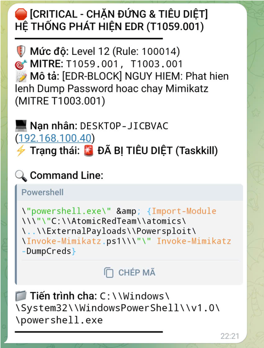
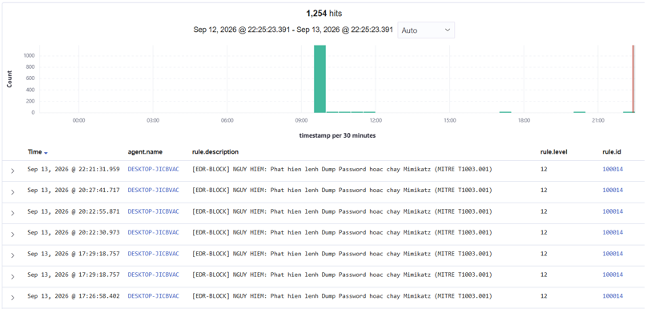
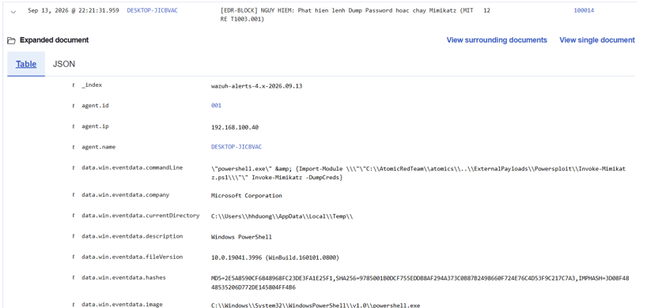
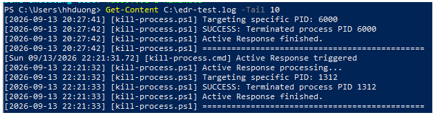

# Wazuh EDR - Phát hiện và phản ứng với PowerShell độc hại (MITRE T1059.001)

Đề tài: Nghiên cứu giải pháp Endpoint Detection and Response (EDR) và triển khai thử nghiệm trên nền tảng mã nguồn mở Wazuh.
Học viện Kỹ thuật Mật mã - Khoa An toàn thông tin.

## Mô tả

Lab dùng Wazuh kết hợp Sysmon để phát hiện các hành vi lạm dụng PowerShell
(MITRE ATT&CK **T1059.001 - Command and Scripting Interpreter: PowerShell**),
tự động kill tiến trình qua Active Response và gửi cảnh báo qua Telegram.

Các hành vi được phát hiện: lệnh mã hóa Base64, chạy ẩn cửa sổ, download cradle,
bỏ qua ExecutionPolicy, và PowerShell sinh ra từ tiến trình cha đáng ngờ.

## Luồng hoạt động

```
Windows Endpoint (Sysmon Event 1) -> Wazuh Agent -> Wazuh Manager (rule 1000xx)
        ^                                                   |
        |                 Active Response (kill-process.cmd)|
        +---------------------------------------------------+
                                                            +--> Telegram
```

## Các rule

| Rule ID | Level | Hành vi | Kill tiến trình |
|---|---|---|---|
| 100010 | 10 | PowerShell chạy lệnh Base64 (`-enc`) | Không |
| 100011 | 10 | PowerShell chạy ẩn cửa sổ (`-w hidden`) | Không |
| 100012 | 12 | PowerShell download cradle (`DownloadString`, `IEX`...) | Có |
| 100013 | 8 | Bỏ qua ExecutionPolicy / NoProfile | Không |
| 100014 | 13 | PowerShell sinh ra từ Office, `wscript`, `mshta`... | Có |

Rule gắn nhóm `powershell_kill_trigger` sẽ kích hoạt Active Response. Thay đổi nhóm này
trong `wazuh-server/rules/local_rules.xml` để chọn rule nào được phép kill.

## Cấu trúc thư mục

```
wazuh-server/
  rules/local_rules.xml            Rule phát hiện 100010-100014
  ossec.conf.snippet.xml           <command>, <active-response>, <integration>
  integrations/                    Script gửi cảnh báo Telegram
windows-endpoint/
  active-response/kill-process.cmd Script kill PowerShell
  agent-ossec.conf.snippet.xml     Cấu hình agent thu log Sysmon
  sysmon/                          Hướng dẫn cấu hình Sysmon
lab/test-scenario.md               Lệnh kiểm thử và kết quả mong đợi
docs/images/                       Ảnh minh chứng
```

## Yêu cầu

- Wazuh Manager (đã cài Indexer và Dashboard)
- Windows Endpoint có Wazuh Agent và Sysmon (bật Event ID 1)
- Bot Telegram (token và chat ID) nếu muốn nhận cảnh báo

## Cách triển khai

1. **Sysmon trên Windows**: cài theo `windows-endpoint/sysmon/README.md`.
2. **Agent Windows**: thêm nội dung `agent-ossec.conf.snippet.xml` vào
   `C:\Program Files (x86)\ossec-agent\ossec.conf`, rồi `Restart-Service -Name wazuh`.
3. **Script kill**: copy `kill-process.cmd` vào
   `C:\Program Files (x86)\ossec-agent\active-response\bin\` trên agent.
4. **Rule trên Manager**: thêm `local_rules.xml` vào `/var/ossec/etc/rules/local_rules.xml`.
5. **Cấu hình Manager**: thêm nội dung `ossec.conf.snippet.xml` vào `/var/ossec/etc/ossec.conf`,
   thay `<YOUR_BOT_TOKEN>` và `<YOUR_CHAT_ID>` bằng giá trị thật.
6. **Telegram** (nếu dùng): copy `custom-telegram` và `custom-telegram.py` vào `/var/ossec/integrations/`:
   ```bash
   sudo chown root:wazuh /var/ossec/integrations/custom-telegram*
   sudo chmod 750 /var/ossec/integrations/custom-telegram*
   ```
7. Restart Manager: `sudo systemctl restart wazuh-manager`.

## Kiểm thử

Xem `lab/test-scenario.md`. Kiểm tra cảnh báo trên Wazuh Dashboard, log
`active-responses.log` trên agent và tin nhắn Telegram.

## Kết quả
1 thông báo được đẩy về người giám sát thông qua telegram

Quản trị viên kiểm tra trên Dashboard 

Kiểm tra cảnh báo chi tiết

Agent trên máy victim thực hiện active respone


## Hạn chế và hướng phát triển

- Script kill đang dừng toàn bộ `powershell.exe` trên máy, chưa lọc theo PID hoặc tài khoản.
- Rule dựa trên mẫu dòng lệnh nên có thể bị né bằng kỹ thuật làm rối chuỗi lệnh.
- Hướng mở rộng: bật PowerShell Script Block Logging (Event ID 4104), thêm rule tương quan
  nhiều sự kiện, và mở rộng sang các kỹ thuật khác trong T1059 (cmd, WMI, script host).

## Lưu ý

Chỉ dùng cho mục đích học tập trong môi trường lab. Script Active Response sẽ kill tiến trình,
không chạy trên máy thật hoặc máy chủ đang vận hành. Không commit token, chat ID hay mật khẩu thật.
